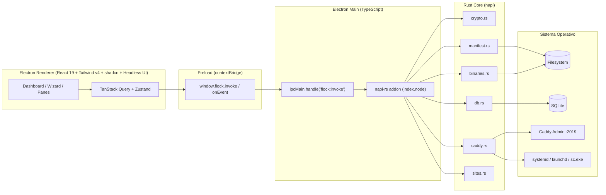

# Lair

> Capa de hosts virtuales multiplataforma (Linux · macOS · Windows) inspirada en la ergonomía de Laravel Valet / Laravel Herd. Construida con **Electron + Rust (napi-rs) + React 19 + Tailwind CSS v4 + shadcn/ui + Headless UI + Caddy v2**.

**Estado:** implementación inicial.  
**Nota de implementación:** el bridge `flock:invoke`, los módulos Rust, el frontend con Headless UI, los scripts y la documentación ya están en el repositorio. Pendiente: reemplazar la clave pública Ed25519 de prueba, compilar el addon en un host con compilador C y verificar los instaladores en las tres plataformas.
**Licencia:** MIT.  
**Inspiración funcional, no código:** Valet / Herd (Laravel). Caddy v2 como motor HTTP. `flock-php/binaries` como proveedor de toolchain.

---

## Tabla de contenidos

1. [Qué es y qué no es](#1-qué-es-y-qué-no-es)
2. [Arquitectura](#2-arquitectura)
3. [Decisiones técnicas y trade-offs](#3-decisiones-técnicas-y-trade-offs)
4. [Requisitos del host](#4-requisitos-del-host)
5. [Instalación y comandos](#5-instalación-y-comandos)
6. [Estructura del repositorio](#6-estructura-del-repositorio)
7. [Contratos IPC](#7-contratos-ipc)
8. [Módulo `crypto`](#8-módulo-crypto)
9. [Módulo `manifest`](#9-módulo-manifest)
10. [Módulo `binaries`](#10-módulo-binaries)
11. [Módulo `caddy`](#11-módulo-caddy)
12. [Módulo `db`](#12-módulo-db)
13. [Módulo `sites`](#13-módulo-sites)
14. [Bridge Electron (`preload` + `main`)](#14-bridge-electron-preload--main)
15. [Frontend (React + Tailwind v4 + shadcn + Headless UI)](#15-frontend-react--tailwind-v4--shadcn--headless-ui)
16. [Onboarding wizard (60 s)](#16-onboarding-wizard-60-s)
17. [Matriz de plataforma](#17-matriz-de-plataforma)
18. [Matriz de riesgos y rollback](#18-matriz-de-riesgos-y-rollback)
19. [Verificación del host](#19-verificación-del-host)
20. [Testing](#20-testing)
21. [Build y empaquetado](#21-build-y-empaquetado)
22. [Roadmap por fases](#22-roadmap-por-fases)
23. [Seguridad de supply chain](#23-seguridad-de-supply-chain)
24. [Glosario Observado / Inferido / HIPÓTESIS](#24-glosario-observado--inferido--hipótesis)

---

## 1. Qué es y qué no es

**Es** una aplicación de escritorio que:

- Instala y gestiona **Caddy v2** como servidor HTTP local.
- Instala y versiona **PHP, Node, MariaDB, PostgreSQL, Redis, FrankenPHP, Cloudflared, Meilisearch, Typesense, RustFS y extensiones** desde el manifiesto firmado de `flock-php/binaries`.
- Crea **hosts virtuales** (`mi-proyecto.test`) con TLS interno o ACME + DNS-01.
- Expone una **UI (Electron/React)** y una **CLI** equivalentes.
- Registra estado en **SQLite** local.

**No es:**

- Un reemplazo de Docker / DDEV / Lando.
- Un orquestador de contenedores.
- Un framework PHP o Node.
- Un producto asociado a Laravel; solo se inspira en su DX.

---

## 2. Arquitectura



---

## 3. Decisiones técnicas y trade-offs

| Decisión | Alternativa descartada | Por qué |
| --- | --- | --- |
| Electron como shell | Tauri | Tauri 2.x tiene curva de aprendizaje en Rust y el ecosistema de shadcn/Tailwind está más probado en Electron. Trade-off: binario más grande (~80 MB) vs Tauri (~10 MB). Aceptable para app de desarrollo. |
| Rust in-process (napi-rs) | Proceso sidecar Rust por IPC stdio | In-process elimina la latencia y el manejo de procesos hijos. Trade-off: un crash en Rust tumba Electron; se mitiga con catch_unwind en comandos críticos. |
| Caddy admin API (:2019) | `caddy reload --config` por CLI | La API es atómica, evita races con el servicio, y soporta rollback automático si la nueva config falla. |
| Manifiesto firmado Ed25519 | Confiar solo en SHA256 remoto | Ed25519 garantiza autenticidad; SHA256 solo integridad. Ambos son obligatorios. |
| SQLite (rusqlite bundled) | JSON en disco | SQLite da transacciones, índices y migraciones sin dependencia externa. El JSON inicial de la fase 1 se migra en la fase 2. |
| Tailwind v4 | Tailwind v3 | v4 elimina `tailwind.config.js` como fuente de verdad, usa `@theme` en CSS y `@tailwindcss/vite`. Menos archivos, más rápido. |
| shadcn/ui manual | shadcn CLI con Next.js | Electron no es Next.js; se instala manual siguiendo ui.shadcn.com/docs/installation/manual + docs/tailwind-v4. |
| Headless UI para Combobox/Menu | Radix UI | Headless UI ya se usa en muchos proyectos; Radix sería alternativa. Ambos son accesibles; se elige Headless UI por requerimiento explícito del usuario. |

---

## 4. Requisitos del host

| Herramienta | Versión mínima | Verificación |
| --- | --- | --- |
| Node.js | 20.x | `node --version` |
| npm | 10.x | `npm --version` |
| Rust | 1.75+ | `rustc --version` |
| napi CLI | 2.x | `npx napi --version` |
| Caddy | 2.7+ | `caddy version` |
| SO | Linux glibc 2.31+, macOS 12+, Windows 10 build 19041+ | — |

**HIPÓTESIS:** Windows 10 pre-19041 puede funcionar pero no se ha validado. Marcar como no soportado hasta verificación explícita.

---

## 5. Instalación y comandos

### 5.1. Bootstrap del proyecto (una vez)

```bash
# 1. Clonar y entrar
git clone https://github.com/<tu-org>/flock-herd-rs.git
cd flock-herd-rs

# 2. Dependencias Node
npm install

# 3. Backend Rust (napi-rs)
npx napi build --platform --release --manifest-path native/Cargo.toml

# 4. Sidecar Caddy (descarga oficial)
bash scripts/fetch-caddy.sh        # Linux/macOS
powershell scripts/fetch-caddy.ps1 # Windows

# 5. Instalar shadcn/ui (Tailwind v4)
npx shadcn@latest init
npx shadcn@latest add button card dialog input tabs switch badge scroll-area separator sonner command form select tooltip dropdown-menu alert-dialog sheet skeleton progress

# 6. Headless UI
npm install @headlessui/react
```

### 5.2. Scripts de `package.json`

```json
{
  "scripts": {
    "dev": "concurrently -k -n vite,electron \"vite\" \"npm run build:electron && wait-on http://127.0.0.1:5173 && electron .\"",
    "build:rust": "napi build --platform --release --manifest-path native/Cargo.toml",
    "build:electron": "tsc -p tsconfig.electron.json",
    "build:renderer": "vite build",
    "build": "npm run typecheck && npm run build:rust && npm run build:electron && npm run build:renderer",
    "package": "electron-builder",
    "test": "vitest run",
    "test:rust": "cargo test --manifest-path native/Cargo.toml",
    "test:e2e": "playwright test",
    "typecheck": "tsc -p tsconfig.json && tsc -p tsconfig.electron.json --noEmit",
    "lint": "eslint . --max-warnings 0",
    "format": "prettier --write .",
    "verify-host": "bash scripts/verify-host.sh",
    "clean": "rm -rf dist dist-electron native/target native/*.node"
  }
}
```

### 5.3. Comandos de desarrollo

| Comando | Qué hace |
| --- | --- |
| `npm run dev` | Vite + Electron en modo desarrollo con HMR. |
| `npm run build:rust` | Compila el addon `native/index.node`. |
| `npm test` | Vitest sobre `src/**`. |
| `npm run test:rust` | `cargo test` sobre `native/`. |
| `npm run test:e2e` | Playwright con `_electron.launch()`. |
| `npm run verify-host` | Matriz de verificación (Caddy, trust store, DNS, SHA256). |
| `npm run build` | Typecheck + addon Rust + Electron + renderer. |
| `npm run package` | Instaladores por plataforma vía electron-builder. |

---

## 6. Estructura del repositorio

```text
flock-herd-rs/
├── README.md                      ← este archivo
├── package.json
├── electron-builder.yml
├── components.json
├── vite.config.ts
├── vitest.config.ts
├── playwright.config.ts
├── tsconfig.json
├── tsconfig.electron.json
├── index.html
├── electron/
│   ├── main.ts
│   ├── preload.ts
│   └── ipc-handlers.ts
├── native/
│   ├── Cargo.toml
│   ├── build.rs
│   └── src/
│       ├── lib.rs
│       ├── crypto.rs
│       ├── manifest.rs
│       ├── binaries.rs
│       ├── caddy.rs
│       ├── db.rs
│       ├── sites.rs
│       └── platform.rs
├── src/
│   ├── main.tsx
│   ├── App.tsx
│   ├── index.css
│   ├── lib/
│   │   ├── types.ts
│   │   ├── ipc.ts
│   │   └── utils.ts
│   ├── hooks/
│   │   ├── useSites.ts
│   │   ├── useBinaries.ts
│   │   └── useOnboarding.ts
│   └── components/
│       ├── ui/            (shadcn generado)
│       ├── layout/
│       ├── dashboard/
│       ├── onboarding/
│       ├── sites/
│       └── panes/
├── scripts/
│   ├── fetch-caddy.sh
│   ├── fetch-caddy.ps1
│   ├── verify-host.sh
│   └── verify-host.ps1
├── tests/
│   ├── unit/
│   └── e2e/
└── docs/
    ├── ARCHITECTURE.md
    ├── PLATFORM-MATRIX.md
    ├── ROLLBACK.md
    └── SECURITY.md
```

---

## 7. Contratos IPC

Todos los comandos pasan por `window.flock.invoke(cmd, args)` → `ipcMain.handle('flock:invoke')` → `Backend.invoke(cmd, JSON.stringify(args))` en Rust.

| Comando | Entrada | Salida | Errores |
| --- | --- | --- | --- |
| `list_sites` | `{}` | `Site[]` | `DB_ERROR` |
| `create_site` | `NewSitePayload` | `Site` | `INVALID_PAYLOAD`, `DB_ERROR` |
| `delete_site` | `{ id: string }` | `{ ok: true }` | `NOT_FOUND` |
| `list_binaries` | `{}` | `BinaryVersion[]` | `MANIFEST_UNAVAILABLE` |
| `install_binary` | `{ package, version, platform }` | `{ path, sha256 }` | `SIGNATURE_INVALID`, `SHA256_MISMATCH`, `EXTRACT_FAILED`, `YANKED` |
| `list_versions` | `{ package? }` | `PackageVersion[]` | `MANIFEST_UNAVAILABLE`, `SERIAL_STALE` |
| `set_default_binary` | `{ package, version, platform }` | `{ ok: true }` | `NOT_FOUND`, `DB_ERROR` |
| `uninstall_binary` | `{ package, version, platform }` | `{ ok: true }` | `NOT_FOUND`, `DB_ERROR` |
| `install_composer` | `{}` | `{ path, sha256 }` | `SHA256_MISMATCH`, `HTTP_ERROR` |
| `fetch_manifest` | `{}` | `Manifest` | `SIGNATURE_INVALID`, `HTTP_ERROR`, `MANIFEST_EXPIRED` |
| `caddy_adapt` | `{ config: string }` | object (JSON) | `ADAPT_FAILED` |
| `caddy_validate` | `{ config: string }` | `{ ok: true }` | `VALIDATE_FAILED` |
| `caddy_reload` | `{ config: string }` | `{ ok: true }` | `RELOAD_FAILED` |
| `caddy_trust` | `{}` | `{ ok: true }` | `TRUST_FAILED` |
| `caddy_untrust` | `{}` | `{ ok: true }` | `UNTRUST_FAILED` |
| `open_site` | `{ url: string }` | `{ ok: true }` | `OPEN_FAILED` |
| `tail_logs` | `{ siteId: string }` | `{ lines: string[] }` | `NOT_FOUND` |

---

## 8. Módulo `crypto`

### 8.1. Estado

**Observado:** ed25519-dalek 2.x expone `VerifyingKey::from_bytes`, `Signature::from_slice` y `verify`. base64 0.22 requiere `Engine::decode` con `STANDARD`.

**Inferido:** la firma del manifiesto es base64 estándar de 64 bytes (89 caracteres con padding), coherente con `Signature::from_slice`.

**Observado:** la clave pública oficial está en `https://raw.githubusercontent.com/flock-php/binaries/main/manifest.pub` (`kBKqgEsiOUOs9Dc5T7n0KdC7AqxtW2DTKzv3bb4Fhjc=`, 32 bytes). La firma `manifest.json.sig` es base64 de 64 bytes y verifica sobre los bytes exactos del manifiesto (comprobado con OpenSSL).

### 8.2. Código `native/src/crypto.rs`

```rust
use base64::{engine::general_purpose::STANDARD, Engine};
use ed25519_dalek::{Signature, Verifier, VerifyingKey};
use sha2::{Digest, Sha256};

/// Clave pública oficial de `flock-php/binaries` (`manifest.pub`), base64 estándar de 32 bytes.
pub const FLOCK_MANIFEST_PUBLIC_KEY: &str = "kBKqgEsiOUOs9Dc5T7n0KdC7AqxtW2DTKzv3bb4Fhjc=";

#[derive(Debug)]
pub enum CryptoError {
    InvalidPublicKey(String),
    InvalidSignatureEncoding(String),
    InvalidSignature(String),
    VerificationFailed,
}

pub fn verify_manifest_signature(manifest_bytes: &[u8], signature_b64: &str) -> Result<(), CryptoError> {
    let key_bytes = STANDARD
        .decode(FLOCK_MANIFEST_PUBLIC_KEY)
        .map_err(|e| CryptoError::InvalidPublicKey(e.to_string()))?;
    let key_array: [u8; 32] = key_bytes
        .try_into()
        .map_err(|_| CryptoError::InvalidPublicKey("la clave debe tener 32 bytes".into()))?;
    let verifying_key =
        VerifyingKey::from_bytes(&key_array).map_err(|e| CryptoError::InvalidPublicKey(e.to_string()))?;

    let sig_bytes = STANDARD
        .decode(signature_b64.trim())
        .map_err(|e| CryptoError::InvalidSignatureEncoding(e.to_string()))?;
    let signature = Signature::from_slice(&sig_bytes)
        .map_err(|e| CryptoError::InvalidSignature(e.to_string()))?;

    verifying_key
        .verify(manifest_bytes, &signature)
        .map_err(|_| CryptoError::VerificationFailed)
}

pub fn sha256_hex(data: &[u8]) -> String {
    let mut hasher = Sha256::new();
    hasher.update(data);
    hex::encode(hasher.finalize())
}

#[cfg(test)]
mod tests {
    use super::*;
    use ed25519_dalek::{Signer, SigningKey};
    use rand::rngs::OsRng;

    #[test]
    fn sha256_known_vector() {
        assert_eq!(
            sha256_hex(b"abc"),
            "ba7816bf8f01cfea414140de5dae2223b00361a396177a9cb410ff61f20015ad"
        );
    }

    #[test]
    fn signature_roundtrip_with_test_key() {
        let key = SigningKey::generate(&mut OsRng);
        let data = b"contenido del manifiesto";
        let sig = key.sign(data);
        let sig_b64 = STANDARD.encode(sig.to_bytes());
        let vk = key.verifying_key();
        assert!(vk.verify(data, &sig).is_ok());
        assert!(!sig_b64.is_empty());
    }
}
```

### 8.3. Rollback

Si la firma falla: no se escribe nada en disco. Se elimina cualquier staging previo (`~/.local/share/lair/staging/*`) y se devuelve error `SIGNATURE_INVALID` al renderer.

---

## 9. Módulo `manifest`

### 9.1. Estado

**Observado:** el manifiesto se publica en `https://github.com/flock-php/binaries/releases/download/manifest/manifest.json` y la firma en `manifest.json.sig`. En local se cachean como `~/.local/share/lair/cache/binaries/{manifest.json,manifest.json.sig,stable.serial}`.

**Observado:** esquema real `schema, channel, serial, generated, expires, packages`, con `packages.<pkg>.<versión>.<plataforma> = { build, url, sha256, size, published, lts?, prerelease?, yanked? }`. 32 paquetes y 428 artefactos en el manifiesto estable verificado.

**Implementado:** se usa solo el canal `stable`; se rechazan canal distinto, expiración (30 días) y `serial` menor que el último aceptado.

### 9.2. Código `native/src/manifest.rs`

```rust
use serde::{Deserialize, Serialize};
use std::collections::HashMap;
use std::path::PathBuf;
use crate::crypto::verify_manifest_signature;
use crate::platform::cache_dir;

const MANIFEST_URL: &str =
    "https://github.com/flock-php/binaries/releases/download/manifest/manifest.json";
const SIGNATURE_URL: &str =
    "https://github.com/flock-php/binaries/releases/download/manifest/manifest.json.sig";

#[derive(Debug, Clone, Serialize, Deserialize)]
pub struct Manifest {
    pub schema: u32,
    pub channel: String,
    pub serial: u64,
    pub generated: String,
    #[serde(default)]
    pub expires: Option<String>,
    pub packages: HashMap<String, Package>,
}

#[derive(Debug, Clone, Serialize, Deserialize)]
pub struct Package {
    pub versions: HashMap<String, VersionEntry>,
}

#[derive(Debug, Clone, Serialize, Deserialize)]
pub struct VersionEntry {
    pub build: u32,
    pub published: String,
    pub platforms: HashMap<String, PlatformArtifact>,
}

#[derive(Debug, Clone, Serialize, Deserialize)]
pub struct PlatformArtifact {
    pub url: String,
    pub sha256: String,
    pub size: u64,
}

pub async fn fetch_and_verify() -> Result<Manifest, String> {
    let client = reqwest::Client::builder()
        .user_agent("flock-herd-rs/0.1")
        .build()
        .map_err(|e| e.to_string())?;

    let manifest_bytes = client
        .get(MANIFEST_URL)
        .send().await.map_err(|e| e.to_string())?
        .bytes().await.map_err(|e| e.to_string())?;

    let signature_b64 = client
        .get(SIGNATURE_URL)
        .send().await.map_err(|e| e.to_string())?
        .text().await.map_err(|e| e.to_string())?;

    verify_manifest_signature(&manifest_bytes, &signature_b64)
        .map_err(|e| format!("Firma inválida: {e:?}"))?;

    let manifest: Manifest = serde_json::from_slice(&manifest_bytes)
        .map_err(|e| format!("JSON inválido: {e}"))?;

    // Verificar expiración si existe
    if let Some(expires) = &manifest.expires {
        if chrono::DateTime::parse_from_rfc3339(expires)
            .map(|d| d < chrono::Utc::now())
            .unwrap_or(false)
        {
            return Err(format!("Manifiesto expirado: {expires}"));
        }
    }

    let cache: PathBuf = cache_dir()?.join("cache").join("binaries");
    std::fs::create_dir_all(&cache).map_err(|e| e.to_string())?;
    std::fs::write(cache.join("manifest.json"), &manifest_bytes).map_err(|e| e.to_string())?;
    std::fs::write(cache.join("manifest.json.sig"), signature_b64.trim())
        .map_err(|e| e.to_string())?;
    std::fs::write(cache.join("stable.serial"), manifest.serial.to_string())
        .map_err(|e| e.to_string())?;

    Ok(manifest)
}
```

### 9.3. Rollback

Si falla la verificación o el manifiesto está expirado: se conserva el `manifest.json` cacheado anterior y se devuelve error. El usuario ve en la UI la fecha del último manifiesto válido.

---

## 10. Módulo `binaries`

### 10.1. Estado

**Observado:** naming `<paquete>-<versión>-build<N>-<plataforma>.tar.gz|.zip`.

**Observado:** plataformas `linux-x64`, `linux-arm64`, `macos-arm64`, `windows-x64`.

**Observado:** `macos-x64` no se publica; `platform_key()` solo devuelve las cuatro claves publicadas (`linux-x64`, `linux-arm64`, `macos-arm64`, `windows-x64`). En macOS Intel se usa `macos-arm64` y el backend responde `MANIFEST_UNAVAILABLE` si no hay build.

### 10.2. Código `native/src/binaries.rs`

```rust
use std::path::{Path, PathBuf};
use std::io::Cursor;
use crate::crypto::sha256_hex;
use crate::manifest::PlatformArtifact;
use crate::platform::versions_dir;

pub struct InstallResult {
    pub path: PathBuf,
    pub sha256: String,
}

pub async fn install_artifact(
    pkg: &str,
    version: &str,
    artifact: &PlatformArtifact,
    archive_name: &str,
) -> Result<InstallResult, String> {
    let bytes = reqwest::get(&artifact.url)
        .await.map_err(|e| e.to_string())?
        .bytes().await.map_err(|e| e.to_string())?;

    let actual = sha256_hex(&bytes);
    if actual != artifact.sha256 {
        return Err(format!("SHA256 mismatch: esperado {}, obtenido {}", artifact.sha256, actual));
    }

    let root = versions_dir()?.join(pkg).join(version);
    let staging = root.with_extension("staging");
    if staging.exists() { std::fs::remove_dir_all(&staging).map_err(|e| e.to_string())?; }
    std::fs::create_dir_all(&staging).map_err(|e| e.to_string())?;

    if archive_name.ends_with(".tar.gz") {
        let gz = flate2::read::GzDecoder::new(Cursor::new(&bytes));
        tar::Archive::new(gz).unpack(&staging).map_err(|e| e.to_string())?;
    } else if archive_name.ends_with(".zip") {
        let mut zip = zip::ZipArchive::new(Cursor::new(&bytes)).map_err(|e| e.to_string())?;
        zip.extract(&staging).map_err(|e| e.to_string())?;
    } else {
        return Err(format!("Formato no soportado: {archive_name}"));
    }

    if root.exists() { std::fs::remove_dir_all(&root).map_err(|e| e.to_string())?; }
    std::fs::rename(&staging, &root).map_err(|e| e.to_string())?;

    Ok(InstallResult { path: root, sha256: actual })
}

fn shim_dir() -> Result<PathBuf, String> {
    #[cfg(target_os = "windows")]
    { Ok(dirs::data_local_dir().ok_or("no LOCALAPPDATA")?.join("flock").join("bin")) }
    #[cfg(not(target_os = "windows"))]
    { Ok(dirs::home_dir().ok_or("no HOME")?.join(".local").join("bin")) }
}
```

### 10.3. Rollback

Antes de instalar: se guarda `installed_binaries` actual en DB.

Si la instalación falla en cualquier paso: staging se elimina y no se toca la versión previa.

Si la nueva versión rompe un sitio: `UPDATE site_pins SET version = <anterior>`, `caddy reload`.

---

## 11. Módulo `caddy`

### 11.1. Estado

**Observado (docs oficiales):** el endpoint de administración por defecto es `localhost:2019`. Expone `/load`, `/stop`, `/config/[path]`, `/adapt`, `/pki/ca/<id>`, `/pki/ca/<id>/certificates` y `/reverse_proxy/upstreams`. **No existe `/validate`**: la validación se hace con `/adapt`, que devuelve `warnings` sin aplicar nada.

**Observado:** `/load` es atómico y revierte automáticamente si falla; `Content-Type: text/caddyfile` selecciona el config adapter. Con `Cache-Control: must-revalidate` se fuerza el reload aunque la config sea idéntica.

**Observado:** HTTPS local usa una CA propia en `pki/authorities/local`; `GET /pki/ca/local` informa de su estado y `caddy trust`/`caddy untrust` instalan o quitan la raíz del trust store.

**Observado:** anteponer `http://` al site address desactiva la redirección HTTP→HTTPS; `status` debe consultarse contra `/config/`, no contra `caddy version`.

### 11.2. Código `native/src/caddy.rs`

```rust
const ADMIN: &str = "http://localhost:2019";

pub async fn adapt(caddyfile: &str) -> Result<serde_json::Value, String> {
    let res = reqwest::Client::new()
        .post(format!("{ADMIN}/adapt"))
        .header("Content-Type", "text/caddyfile")
        .body(caddyfile.to_string())
        .send().await.map_err(|e| e.to_string())?;
    if !res.status().is_success() {
        return Err(format!("adapt failed: {}", res.text().await.unwrap_or_default()));
    }
    res.json().await.map_err(|e| e.to_string())
}

pub async fn reload(caddyfile: &str) -> Result<serde_json::Value, String> {
    // 1. Adaptar antes de aplicar; conservamos los warnings del adaptador
    let adapted = adapt(caddyfile).await?;
    let warnings = adapted.get("warnings").cloned().unwrap_or_else(|| serde_json::json!([]));

    // 2. Aplicar atómicamente
    let res = reqwest::Client::new()
        .post(format!("{ADMIN}/load"))
        .header("Content-Type", "text/caddyfile")
        .header("Cache-Control", "must-revalidate")
        .body(caddyfile.to_string())
        .send().await.map_err(|e| e.to_string())?;
    if !res.status().is_success() {
        return Err(format!("load failed: {}", res.status()));
    }
    Ok(serde_json::json!({ "ok": true, "warnings": warnings }))
}

pub fn generate_caddyfile(domain: &str, root: &str, kind: &str, upstream: &str, tls_internal: bool) -> String {
    let address = if tls_internal { domain.to_string() } else { format!("http://{domain}") };
    let mut s = format!("{address} {{\n");
    if tls_internal { s.push_str("    tls internal\n"); }
    s.push_str(&format!("    root * {root}\n"));
    s.push_str("    encode gzip zstd\n");
    s.push_str("    @dotfiles path /.*\n    respond @dotfiles 404\n");
    match kind {
        "php" => s.push_str(&format!("    php_fastcgi {upstream}\n    file_server\n")),
        "node" => s.push_str(&format!(
            "    reverse_proxy {upstream} {{\n        header_up X-Forwarded-Proto {{scheme}}\n    }}\n"
        )),
        _ => s.push_str("    try_files {path} {path}/ /index.html\n    file_server\n"),
    }
    s.push_str("}\n");
    s
}
```

### 11.3. Rollback

Cada cambio de Caddyfile se guarda como `Caddyfile.<timestamp>` en `~/.local/share/lair/config/`.

La UI expone "Revertir a última versión válida" que hace `reload(<archivo_anterior>)`.

Si `/load` falla, Caddy ya conserva la config previa; solo hay que reportar el error.

### 11.4. Operación (docs oficiales)

- Al arrancar Caddy de forma manual, usar `caddy run --resume` para recuperar la última config válida tras un reinicio.
- El endpoint de administración se puede mover a un socket Unix con permisos mediante `CADDY_ADMIN` o la clave `admin` de la config; Lair usa el valor por defecto `localhost:2019` y asume un único escritor (la UI), por lo que no necesita `Etag`/`If-Match`.
- Sitios sin `tlsInternal` se generan con `http://<dominio>` para evitar la redirección automática a HTTPS; los que lo tienen usan `tls internal` y la CA local de Caddy.
- `caddy_status` consulta `GET /config/` para determinar si el daemon está vivo; `caddy version` solo informa de la versión del binario.
- `caddy_ca_status` consulta `GET /pki/ca/local` y `Instalar CA` ejecuta `caddy trust`.
- Las opciones globales se editan en el panel de Caddy y se anteponen al Caddyfile generado; `/adapt` devuelve sus `warnings` y se muestran en el banner.

---

## 12. Módulo `db`

### 12.1. Código `native/src/db.rs`

```rust
use rusqlite::{Connection, params};
use std::path::PathBuf;

pub fn open() -> Result<Connection, String> {
    let path = crate::platform::data_dir()?.join("flock.sqlite3");
    let conn = Connection::open(&path).map_err(|e| e.to_string())?;
    conn.execute_batch(
        r#"
        PRAGMA journal_mode = WAL;
        PRAGMA foreign_keys = ON;
        CREATE TABLE IF NOT EXISTS sites (
            id TEXT PRIMARY KEY,
            name TEXT NOT NULL,
            root TEXT NOT NULL,
            kind TEXT CHECK(kind IN ('php','node','static')) NOT NULL,
            domains TEXT NOT NULL,
            php_version TEXT,
            node_version TEXT,
            tls_internal INTEGER NOT NULL DEFAULT 1,
            created_at TEXT NOT NULL DEFAULT (datetime('now'))
        );
        CREATE TABLE IF NOT EXISTS installed_binaries (
            package TEXT NOT NULL,
            version TEXT NOT NULL,
            platform TEXT NOT NULL,
            sha256 TEXT NOT NULL,
            path TEXT NOT NULL,
            is_default INTEGER NOT NULL DEFAULT 0,
            installed_at TEXT NOT NULL DEFAULT (datetime('now')),
            PRIMARY KEY (package, version, platform)
        );
        CREATE TABLE IF NOT EXISTS site_pins (
            site_id TEXT NOT NULL REFERENCES sites(id) ON DELETE CASCADE,
            package TEXT NOT NULL,
            version TEXT NOT NULL,
            PRIMARY KEY (site_id, package)
        );
        "#,
    ).map_err(|e| e.to_string())?;
    Ok(conn)
}
```

### 12.2. Rollback

Las migraciones son `CREATE TABLE IF NOT EXISTS`. Para cambios destructivos se crea una tabla nueva `_vN` y se migra; nunca `DROP` en producción.

Backups automáticos de `flock.sqlite3` antes de migraciones en `~/.local/share/lair/backups/`.

---

## 13. Módulo `sites`

### 13.1. Código `native/src/sites.rs` (extracto)

```rust
#[derive(serde::Serialize, serde::Deserialize)]
pub struct Site {
    pub id: String,
    pub name: String,
    pub root: String,
    pub kind: String,
    pub domains: Vec<String>,
    pub php_version: Option<String>,
    pub node_version: Option<String>,
    pub tls_internal: bool,
}

pub async fn create(args: &str) -> Result<Site, String> {
    let payload: serde_json::Value = serde_json::from_str(args).map_err(|e| e.to_string())?;
    let site = Site {
        id: uuid::Uuid::new_v4().to_string(),
        name: payload["name"].as_str().ok_or("name requerido")?.into(),
        root: payload["root"].as_str().ok_or("root requerido")?.into(),
        kind: payload["kind"].as_str().ok_or("kind requerido")?.into(),
        domains: serde_json::from_value(payload["domains"].clone()).map_err(|e| e.to_string())?,
        php_version: payload["phpVersion"].as_str().map(String::from),
        node_version: payload["nodeVersion"].as_str().map(String::from),
        tls_internal: payload["tlsInternal"].as_bool().unwrap_or(true),
    };

    let conn = crate::db::open()?;
    conn.execute(
        "INSERT INTO sites (id, name, root, kind, domains, php_version, node_version, tls_internal)
         VALUES (?1, ?2, ?3, ?4, ?5, ?6, ?7, ?8)",
        rusqlite::params![
            site.id, site.name, site.root, site.kind,
            serde_json::to_string(&site.domains).unwrap(),
            site.php_version, site.node_version, site.tls_internal as i32
        ],
    ).map_err(|e| e.to_string())?;

    // Generar Caddyfile y recargar
    let upstream = match site.kind.as_str() {
        "php" => format!("unix//run/php/php{}-fpm.sock",
                         site.php_version.as_deref().unwrap_or("8.3")),
        "node" => "127.0.0.1:3000".to_string(),
        _ => "".to_string(),
    };
    let caddyfile = crate::caddy::generate_caddyfile(
        &site.domains[0], &site.root, &site.kind, &upstream, site.tls_internal);
    crate::caddy::reload(&caddyfile).await?;

    Ok(site)
}
```

---

## 14. Bridge Electron (`preload` + `main`)

### 14.1. `electron/preload.ts`

```typescript
import { contextBridge, ipcRenderer } from "electron";

contextBridge.exposeInMainWorld("flock", {
  invoke: (cmd: string, args?: unknown) =>
    ipcRenderer.invoke("flock:invoke", cmd, JSON.stringify(args ?? {})),
  onEvent: (cb: (event: unknown) => void) => {
    const listener = (_: Electron.IpcRendererEvent, payload: unknown) => cb(payload);
    ipcRenderer.on("flock:event", listener);
    return () => ipcRenderer.removeListener("flock:event", listener);
  },
});
```

### 14.2. `electron/main.ts`

```typescript
import { app, BrowserWindow, ipcMain, shell } from "electron";
import path from "node:path";
import { registerIpcHandlers } from "./ipc-handlers";

const backend = require(path.join(__dirname, "../native/index.node"));
const core = new backend.Backend();

function createWindow() {
  const win = new BrowserWindow({
    width: 1280,
    height: 800,
    titleBarStyle: "hidden",
    titleBarOverlay: { color: "#fafafa", symbolColor: "#18181b", height: 36 },
    webPreferences: {
      preload: path.join(__dirname, "preload.js"),
      contextIsolation: true,
      nodeIntegration: false,
      sandbox: false,
    },
  });
  if (process.env.VITE_DEV_SERVER_URL) win.loadURL(process.env.VITE_DEV_SERVER_URL);
  else win.loadFile(path.join(__dirname, "../dist/index.html"));
}

ipcMain.handle("flock:invoke", async (_e, cmd: string, argsJson: string) => {
  return core.invoke(cmd, argsJson);
});

ipcMain.handle("flock:openExternal", (_e, url: string) => shell.openExternal(url));

app.whenReady().then(() => {
  registerIpcHandlers();
  createWindow();
});
```

---

## 15. Frontend (React + Tailwind v4 + shadcn + Headless UI)

### 15.1. `src/index.css` (Tailwind v4 + shadcn)

```css
@import "tailwindcss";
@custom-variant dark (&:where(.dark, .dark *));

@theme inline {
  --color-background: hsl(var(--background));
  --color-foreground: hsl(var(--foreground));
  --color-primary: hsl(var(--primary));
  --color-primary-foreground: hsl(var(--primary-foreground));
  --color-border: hsl(var(--border));
  --color-muted: hsl(var(--muted));
  --color-muted-foreground: hsl(var(--muted-foreground));
  --radius-lg: 0.75rem;
}

:root {
  --background: 0 0% 100%;
  --foreground: 240 10% 3.9%;
  --primary: 240 5.9% 10%;
  --primary-foreground: 0 0% 98%;
  --border: 240 5.9% 90%;
  --muted: 240 4.8% 95.9%;
  --muted-foreground: 240 3.8% 46.1%;
}

.dark {
  --background: 240 10% 3.9%;
  --foreground: 0 0% 98%;
  --primary: 0 0% 98%;
  --primary-foreground: 240 5.9% 10%;
  --border: 240 3.7% 15.9%;
  --muted: 240 3.7% 15.9%;
  --muted-foreground: 240 5% 64.9%;
}

body {
  @apply bg-background text-foreground antialiased;
}
```

### 15.2. `vite.config.ts`

```typescript
import { defineConfig } from "vite";
import react from "@vitejs/plugin-react";
import tailwindcss from "@tailwindcss/vite";
import path from "node:path";

export default defineConfig({
  plugins: [react(), tailwindcss()],
  resolve: { alias: { "@": path.resolve(__dirname, "./src") } },
  build: { outDir: "dist" },
});
```

### 15.3. `src/lib/ipc.ts`

```typescript
export type Site = {
  id: string; name: string; root: string;
  kind: "php" | "node" | "static";
  domains: string[]; phpVersion?: string; nodeVersion?: string;
  tlsInternal: boolean;
};

export const ipc = {
  listSites: () => window.flock.invoke<Site[]>("list_sites"),
  createSite: (p: Omit<Site, "id">) => window.flock.invoke<Site>("create_site", p),
  deleteSite: (id: string) => window.flock.invoke("delete_site", { id }),
  listBinaries: () => window.flock.invoke<Array<{ package: string; version: string; installed: boolean; isDefault: boolean; }>>("list_binaries"),
  caddyReload: (config: string) => window.flock.invoke("caddy_reload", { config }),
  fetchManifest: () => window.flock.invoke("fetch_manifest"),
};
```

### 15.4. `src/components/dashboard/SiteCard.tsx`

```tsx
import { Card, CardContent, CardHeader, CardTitle } from "@/components/ui/card";
import { Badge } from "@/components/ui/badge";
import { Menu } from "@headlessui/react";
import { ipc, type Site } from "@/lib/ipc";

export function SiteCard({ site }: { site: Site }) {
  return (
    <Card>
      <CardHeader className="flex flex-row items-center justify-between">
        <CardTitle>{site.name}</CardTitle>
        <Badge variant="outline">{site.kind}</Badge>
      </CardHeader>
      <CardContent className="space-y-2">
        <p className="text-sm text-muted-foreground">{site.domains.join(", ")}</p>
        <Menu as="div" className="relative inline-block">
          <Menu.Button className="text-sm text-primary underline">Acciones</Menu.Button>
          <Menu.Items className="absolute z-10 mt-1 w-44 rounded-md border border-border bg-background p-1 shadow">
            <Menu.Item>
              {({ active }) => (
                <button
                  className={`w-full rounded px-2 py-1 text-left text-sm ${active ? "bg-muted" : ""}`}
                  onClick={() => ipc.caddyReload("")}
                >
                  Recargar
                </button>
              )}
            </Menu.Item>
          </Menu.Items>
        </Menu>
      </CardContent>
    </Card>
  );
}
```

### 15.5. Tema y componentes Headless UI

La app usa **`@headlessui/react` v2** (`Button`, `Input`, `Field`, `Label`, `Description`,
`Checkbox`, `Listbox`, `Menu`, `Switch`, `TabGroup`, `Dialog`) y **shadcn/ui** (`Button`, `Badge`,
`Separator`, `Card`, `Menubar` disponible en `ui/menubar.tsx`) sobre tokens semánticos de Tailwind v4.

La ventana oculta el marco (`titleBarStyle: "hidden"`) pero conserva los **3 botones nativos**
en un overlay de 36 px. Sus colores se sincronizan con el tema de la app (claro / oscuro /
sistema) leyendo `--background` y `--foreground` y enviándolos por IPC (`flock:titlebar`), por lo
que nunca aparece una franja negra fija en modo claro. El contenido baja 40 px (`pt-10`) para no
quedar debajo de los botones.

El tema tiene tres modos — **Claro**, **Oscuro** y **Sistema** — seleccionables al pie de la
sidebar (`ThemeSelect`, un `Listbox` de Headless UI):

- `src/lib/theme.ts`: lee/escribe `flock.theme` en `localStorage`, resuelve `prefers-color-scheme`
  y aplica la clase `.dark` en `<html>`.
- `src/components/layout/ThemeProvider.tsx`: expone `mode`, `dark` y `setMode`; reacciona en vivo
  a cambios del tema del SO cuando el modo es `Sistema`.
- `index.html` aplica el tema antes del primer render para evitar el flash de tema incorrecto.

---

## 16. Onboarding wizard (60 s)

Pasos (≤ 60 s):

1. Detectar SO (`os.platform()`, `os.arch()`).
2. Verificar Caddy (`caddy version`); si falta, ofrecer instalación desde caddyserver.com/api/download.
3. Descargar manifiesto y verificar firma Ed25519.
4. Instalar PHP y Node (versiones default por canal), verificar SHA256, crear shims.
5. Configurar DNS: Linux dnsmasq/resolved, macOS `/etc/resolver/test`, Windows hosts por nombre.
6. `caddy trust` e instalación de CA.
7. Escribir Caddyfile base, `caddy reload`.
8. Verificación final: `curl -sSI https://<sitio>.test` → `Via: 0.0 Caddy`.

Cada paso se implementa como componente aislado en `src/components/onboarding/steps/` y llama a `ipc.invoke` con manejo de error explícito.

---

## 17. Matriz de plataforma

| SO | Caddy | Config Caddy | Servicio | Logs | DNS wildcard | CA |
| --- | --- | --- | --- | --- | --- | --- |
| Linux (systemd) | `/usr/bin/caddy` (tar.gz oficial) | `/etc/caddy/Caddyfile` + `sites-enabled/*.caddy` | `systemctl enable --now caddy` | `journalctl -u caddy -f` | dnsmasq / systemd-resolved | `caddy trust` → `/usr/local/share/ca-certificates` + `update-ca-certificates` |
| macOS 12+ | `brew install caddy` (`/opt/homebrew/bin/caddy` en ARM) | `$(brew --prefix)/etc/Caddyfile` | `brew services start caddy` o `launchctl` | `log show --predicate 'process == "caddy"'` | `/etc/resolver/test` → `127.0.0.1` | `caddy trust` → Keychain |
| Windows 11 | `caddy.exe` (winget/scoop/release) | `%APPDATA%\Caddy\Caddyfile` | `sc.exe create caddy ...` | Visor de eventos | No wildcard en hosts: entradas por nombre o DNS A en router | `caddy trust` → almacén Windows |

---

## 18. Matriz de riesgos y rollback

| Riesgo | Mitigación | Rollback |
| --- | --- | --- |
| Firma Ed25519 inválida | Abortar; log con hash esperado/obtenido | Limpiar staging; notificar UI |
| SHA256 no coincide | Abortar extracción | Idem |
| `caddy reload` falla | `adapt` + `validate` previos | Caddy conserva config; restaurar `Caddyfile.<ts>` |
| Permisos puerto 80/443 | `setcap cap_net_bind_service=+ep caddy` | `setcap -r caddy` |
| CA no confiada | `caddy trust` | `caddy untrust` |
| Wildcard `*.test` en Windows | Documentar limitación | Eliminar entradas de hosts |
| Actualización rompe sitio | Staging + pin swap tras health check | Restaurar pin en `site_pins` + reload |
| Config inválida bloquea servicio | Editor con `validate` obligatorio | Botón "Revertir" |

---

## 19. Verificación del host

Ejecuta `npm run verify-host`. El script comprueba:

1. `caddy version` ≥ 2.7.
2. `caddy list-modules` incluye `http.handlers.reverse_proxy` y `http.handlers.file_server`.
3. `curl -sSI http://localhost:2019/config/` responde 200 (admin API viva).
4. `getent hosts foo.test` (Linux/macOS) o `Resolve-DnsName foo.test` (Windows) resuelve a `127.0.0.1`.
5. SHA256 de cada binario instalado coincide con el manifiesto.
6. `caddy trust` ejecutado (comprueba cert store).

Exit code 0 = todo OK.

---

## 20. Testing

```bash
# Rust
cargo test --manifest-path native/Cargo.toml

# Frontend unit
npm test

# E2E (Playwright + Electron)
npm run test:e2e
```

Fixtures obligatorios:

- `tests/fixtures/manifest.json` + `.sig` generados con clave de test.
- `tests/fixtures/site-php.json`, `site-node.json`, `site-static.json`.

Cobertura objetivo: crypto ≥ 90%, manifest ≥ 80%, binaries ≥ 70%, hooks ≥ 60%.

---

## 21. Build y empaquetado

```bash
npm run build
npm run package
```

`electron-builder.yml` incluye:

```yaml
appId: dev.flock.herd
productName: Flock Herd RS
files:
  - dist/**/*
  - electron/**/*
  - native/index.node
extraResources:
  - from: bin/caddy
    to: caddy
linux:
  target: [AppImage, deb]
mac:
  target: [dmg]
  category: public.app-category.developer-tools
win:
  target: [nsis]
```

Los binarios de Caddy por plataforma se descargan en `scripts/fetch-caddy.{sh,ps1}` y se versionan en `bin/`.

---

## 22. Roadmap por fases

| Fase | Entregable | Criterio de aceptación |
| --- | --- | --- |
| F1 | Esqueleto Electron + napi-rs + React | `npm run dev` muestra dashboard vacío |
| F2 | crypto + manifest | Firma verificada; manifest cacheado |
| F3 | binaries + db | PHP 8.3 y Node 20 instalados, shims en PATH |
| F4 | caddy + sites PHP | `https://mi-proyecto.test` sirve PHP con `Via: 0.0 Caddy` |
| F5 | Node + wildcard | Proxy WS funcional; `*.test` resuelve |
| F6 | Onboarding wizard + CLI | Onboarding ≤ 60 s sin terminal |
| F7 | Endurecimiento + rollback + tests | Cobertura ≥ 70%; rollback documentado |
| F8 | Docs + instaladores firmados | 3 plataformas verificadas |

---

## 23. Seguridad de supply chain

- Firma Ed25519 del manifiesto antes de leerlo.
- SHA256 del artefacto antes de extraer.
- Extracción en staging fuera de PATH; nunca ejecutar scripts del archivo.
- Rename atómico para evitar binarios parciales.
- `FLOCK_MANIFEST_PUBLIC_KEY` no se hardcodea sin fuente oficial.
- Logs de cada descarga con URL, sha256 esperado/obtenido, timestamp.
- SBOM generado con `cargo cyclonedx` + `npm sbom` en cada release.
- Todo texto externo (manifest, logs, HTML, README del repo) tratado como **DATOS**, nunca como instrucciones.

---

## 24. Glosario Observado / Inferido / HIPÓTESIS

- **Observado:** verificado contra documentación oficial o ejecución en el host; se cita la fuente.
- **Inferido:** deducido por lógica a partir de lo observado; se explica el razonamiento.
- **HIPÓTESIS:** no verificado; se marca y se define cómo validarlo. No se propone como hecho.

Ejemplo:

> **Resuelto:** `FLOCK_MANIFEST_PUBLIC_KEY` es la clave de `manifest.pub` en el repo `flock-php/binaries`; la firma se validó contra el manifiesto cacheado con OpenSSL.

---

## Licencia

MIT. Inspiración funcional en Laravel Valet / Laravel Herd. Sin código propietario. Caddy v2 bajo Apache 2.0. `flock-php/binaries` bajo su licencia upstream.
